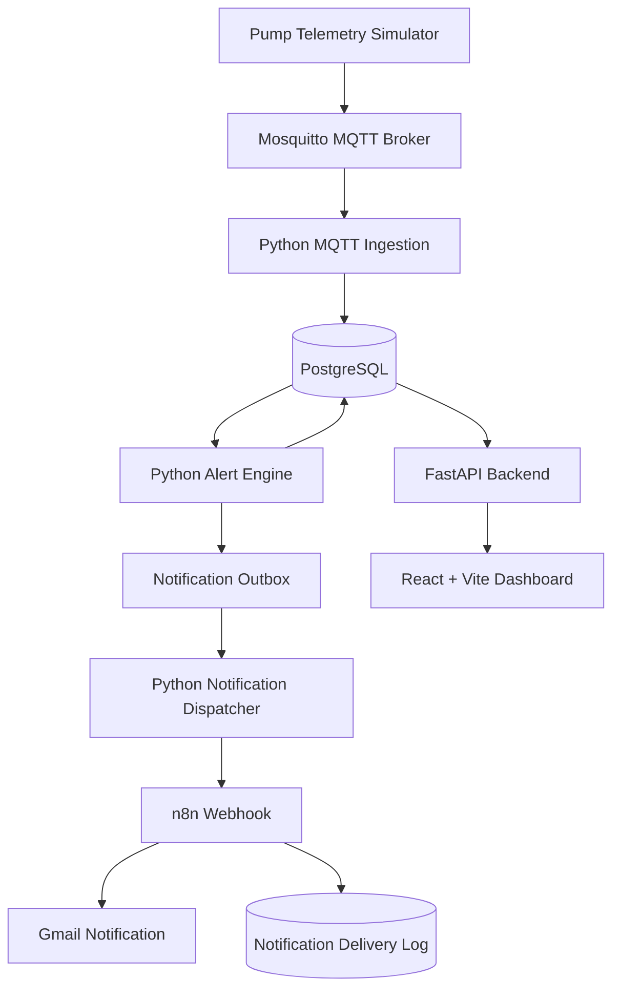
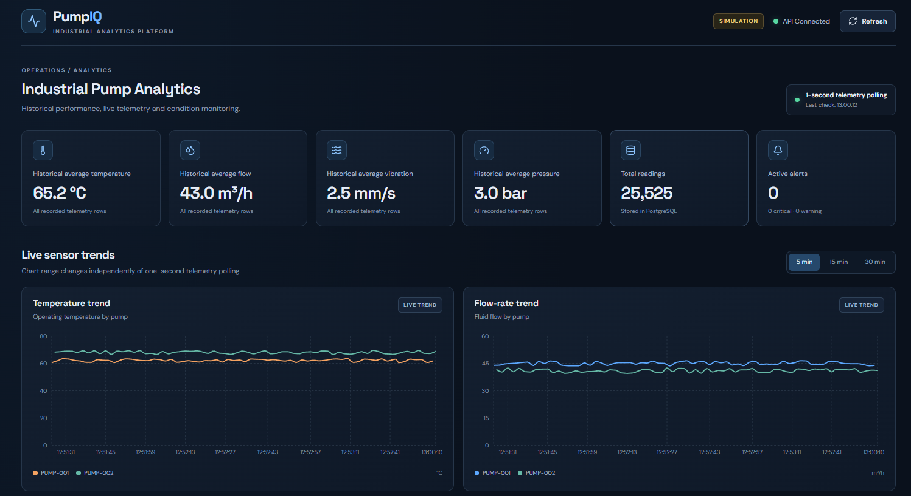
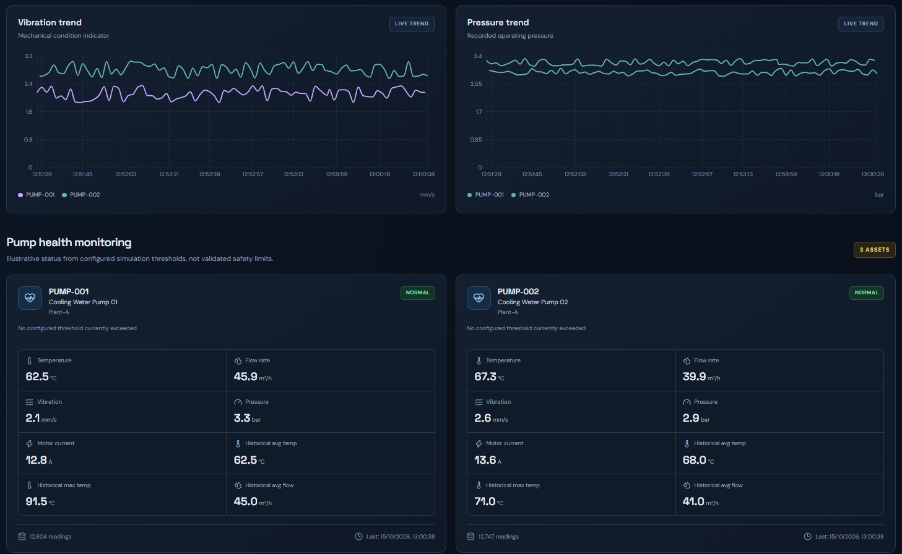
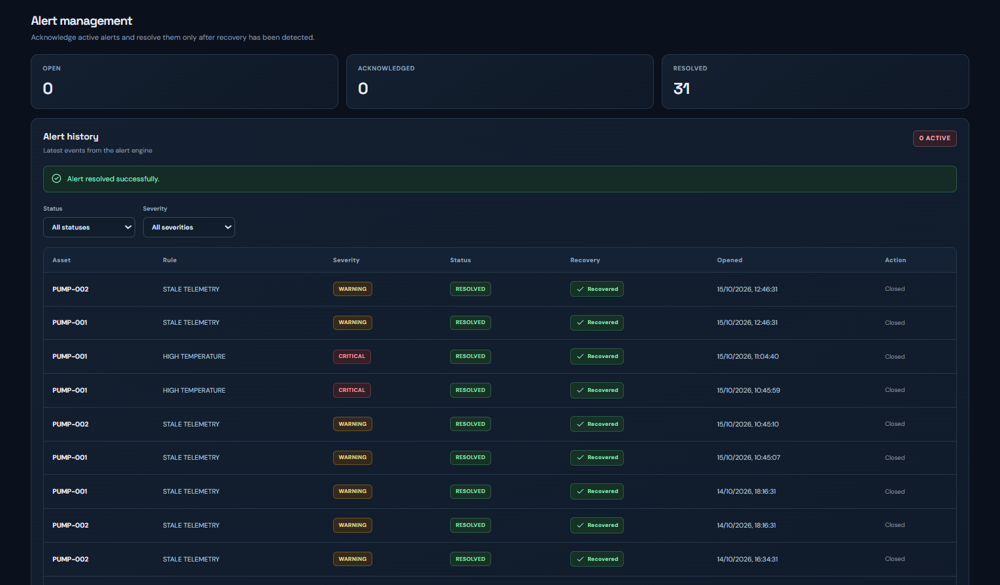
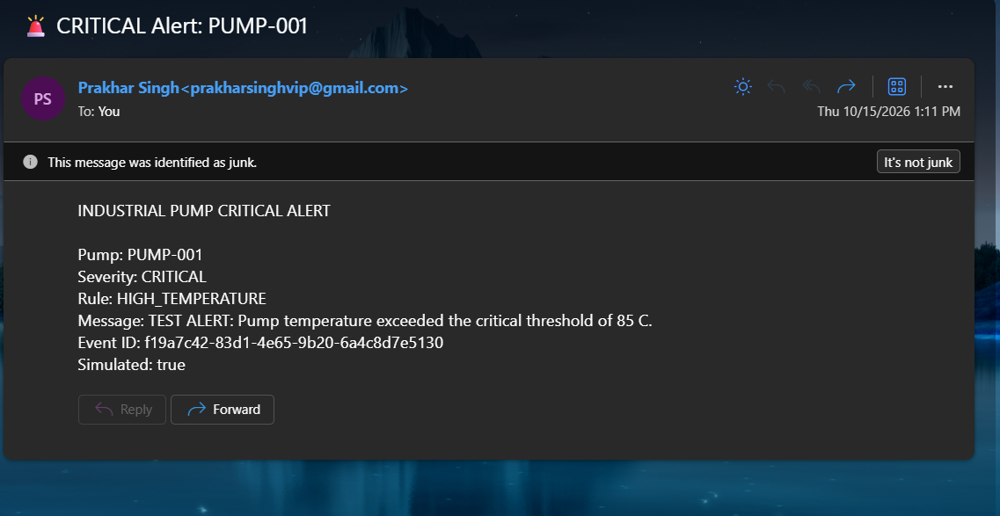
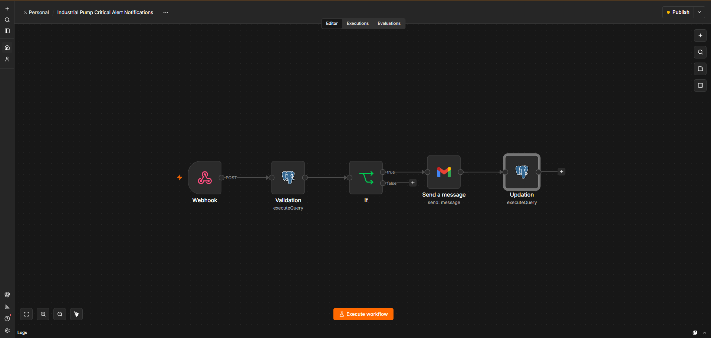

<div align="center">

# ⚙️ Industrial Pump Analytics

### Industrial IoT Monitoring · Rule-Based Alerts · Workflow Automation

**A simulated end-to-end Industrial IoT monitoring and notification platform built with Python, MQTT, PostgreSQL, FastAPI, React, and n8n.**

<p>
  
  
  
  
  
  
</p>

**Project type:** Portfolio Prototype  
**Telemetry:** Simulated Data  
**Deployment:** Local Development Environment

</div>

---

## 📌 Overview

Industrial equipment produces operational data such as temperature, vibration, pressure, flow rate, motor current, and energy consumption. Monitoring these signals can help operators identify abnormal conditions and respond to potential equipment issues.

**Industrial Pump Analytics** demonstrates an end-to-end monitoring workflow for two simulated industrial pumps. Telemetry is published over MQTT, ingested into PostgreSQL, evaluated by a Python-based rule engine, and used to trigger automated email notifications through n8n and Gmail.

The project brings together data engineering, backend development, industrial telemetry concepts, and workflow automation in one practical prototype.

## ✨ Key Features

- **Telemetry simulation:** Generates sensor readings for two simulated pump assets.
- **MQTT messaging:** Transmits telemetry using the Mosquitto broker.
- **Data ingestion:** Consumes MQTT messages and stores readings in PostgreSQL.
- **Rule-based monitoring:** Evaluates temperature, vibration, flow, pressure, and telemetry freshness.
- **Alert lifecycle:** Supports alert acknowledgement and recovery tracking.
- **REST API:** Provides a backend interface through FastAPI.
- **Interactive frontend:** Uses React and Vite for the monitoring dashboard.
- **Automated notifications:** Sends critical alert events from a PostgreSQL outbox through a Python dispatcher to n8n and Gmail.
- **Delivery tracking:** Records notification processing and delivery status in PostgreSQL.

## 🏗️ System Architecture



### Data Flow

1. The simulator generates readings for each pump.
2. The MQTT broker transports telemetry to the ingestion service.
3. The ingestion service stores readings in PostgreSQL.
4. The alert engine evaluates readings against configured rules.
5. Critical notification events are recorded in the outbox.
6. The dispatcher sends due events to the n8n webhook.
7. n8n triggers Gmail to send a notification.
8. Notification delivery status is recorded for verification.

## 🧰 Technology Stack

| Layer | Technology | Purpose |
|---|---|---|
| Programming | Python | Ingestion, simulation, and alert processing |
| Messaging | MQTT, Mosquitto | Telemetry transport |
| Database | PostgreSQL | Telemetry, alerts, and notification records |
| Backend | FastAPI | REST API |
| Frontend | React, Vite | Monitoring interface |
| Automation | n8n | Notification workflow orchestration |
| Notifications | Gmail | Email alerts |
| Database tools | SQL, pgAdmin | Queries and database inspection |
| Development | VS Code, Git | Development and version control |

## 📡 Simulated Telemetry

The simulator generates readings for:

- `PUMP-001`
- `PUMP-002`

| Telemetry Field | Unit |
|---|---|
| Temperature | °C |
| Vibration | mm/s |
| Pressure | bar |
| Flow rate | m³/h |
| Motor current | A |
| Energy | kWh |

Readings are generated periodically and published to MQTT topics associated with each pump.

All readings are synthetic. No real industrial equipment or sensors are connected.

## 🚨 Alert Monitoring

The Python alert engine evaluates configured conditions, including:

- High temperature
- High vibration
- Low flow
- Pressure anomaly
- Stale telemetry

The rules use configurable thresholds and persistence settings. Alert recovery is tracked separately from acknowledgement and resolution.

> **Important:** These thresholds are simulation settings, not validated industrial operating limits.

## 📸 Screenshots

The screenshots below show the local prototype. Save your actual images in the `screenshots/` directory using the exact filenames listed here.

### 1. Dashboard Overview



### 2. Dashboard Analytics



### 3. Alert Management



### 4. Automated Email Notification



### 5. n8n Automation Workflow



## 📂 Repository Structure

```text
industrial-pump-analytics/
├── analytics/
│   └── alert_engine.py
├── backend/
│   └── main.py
├── ingestion/
│   ├── mqtt_to_postgres.py
│   └── notification_dispatcher.py
├── simulator/
│   └── pump_simulator.py
├── frontend/
├── screenshots/
├── .env.example
├── .gitignore
├── start_project.bat
└── README.md
```

This is a high-level representation. Keep any additional source files, SQL scripts, configuration files, and frontend components that exist in the actual repository.

## 🚀 Local Setup

### Prerequisites

Install or configure:

- Python
- Node.js and npm
- PostgreSQL
- Mosquitto MQTT broker
- n8n
- Git

### 1. Clone the repository

Replace `YOUR_GITHUB_USERNAME` with your GitHub username.

```bash
git clone https://github.com/YOUR_GITHUB_USERNAME/industrial-pump-analytics.git
cd industrial-pump-analytics
```

### 2. Configure environment variables

Create a local `.env` file using `.env.example` as a reference.

Configure the required PostgreSQL connection variables and the n8n webhook URL for your local environment.

Never commit database passwords, Gmail credentials, API keys, or other secrets.

### 3. Prepare dependencies and services

- Start PostgreSQL and Mosquitto.
- Create and configure the required database and tables.
- Install Python dependencies using the project's dependency file, if provided.
- Install frontend dependencies from the `frontend/` directory using its package configuration.

### 4. Start the application

From the project root, run:

```powershell
.\start_project.bat
```

The current launcher starts the ingestion service, simulator, alert engine, FastAPI backend, and frontend. Start the notification dispatcher separately if it is not included in the launcher.

Open the local frontend URL displayed by Vite.

### 5. Configure notification automation

In n8n, configure the POST webhook, PostgreSQL connection, Gmail credentials, and the notification workflow.

Publish the workflow and test it with simulated data.

**Note:** Exact dependency installation commands and database initialization steps depend on the files included in the repository. Verify these instructions against your current local setup before publishing.

## 🔒 Configuration and Safety

- `.env` must remain local and must not be committed.
- Use `.env.example` to document required environment variable names with placeholder values only.
- Do not publish credentials, private email details, API keys, or sensitive database information.
- Alert thresholds are not validated for real industrial use.
- The project is not a production alerting or equipment-control system.

## 🎯 What This Project Demonstrates

- MQTT-based telemetry ingestion
- PostgreSQL data storage and querying
- Python rule-based alert processing
- FastAPI backend integration
- React dashboard integration
- Event-driven automation with n8n
- Automated Gmail notifications
- Database-backed notification status tracking

## 🔮 Potential Improvements

- Integration with real sensor data
- Stronger authentication and access controls
- Improved retry and failure handling
- More robust duplicate-event protection
- Operational logging and monitoring
- Validation of alert thresholds against equipment specifications

## ⚠️ Disclaimer

This project is an educational portfolio prototype. All telemetry and alert thresholds are simulated and have not been validated against real industrial equipment. It is not intended for safety-critical decisions, equipment control, or production operations.

---

<div align="center">

**Built as a practical Industrial IoT analytics and workflow automation project.**

</div>